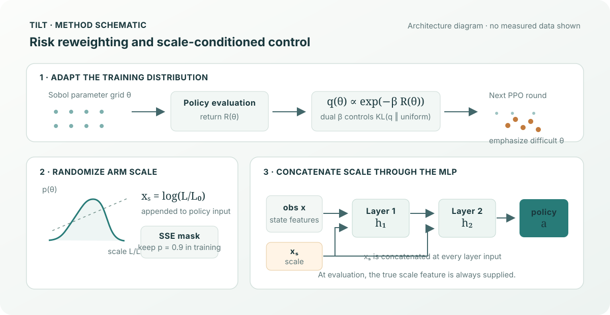

# TILT

**Tail-Aware Iterative Learning via Tilting** is a Genesis-based quadrotor hover-control project. It combines PPO with iterative domain-randomization reweighting, a scale-conditioned policy, and stochastic scale exposure.

[Academic project homepage](https://paoshou-china.github.io/TILT/) · [Quick start](#quick-start) · [Method](#method-overview) · [Evaluation](#evaluation) · [Source](https://github.com/PaoShou-China/TILT)



## Method overview

Training alternates between PPO optimization and adapting the dynamics-parameter sampling distribution:

1. **Entropic-risk reweighting:** returns measured on a fixed Sobol parameter grid are converted into weights for sampling the next training round.
2. **Dual-β update:** the tilt parameter is adjusted against a target KL divergence; an effective-sample-size guard limits distribution collapse.
3. **Scale-conditioned policy:** the log arm-scale feature is concatenated into each layer input of the policy trunk.
4. **Stochastic Scale Exposure (SSE):** during training, the scale feature is kept per sample with probability `SCALE_KEEP_P` (default 0.9); evaluation uses the true scale feature.

The code implements a simulated quadrotor hover task using Genesis. It does not include a real vehicle deployment.

## Requirements and installation

The documented environment targets Linux, an NVIDIA GPU, Python 3.10, and CUDA-compatible PyTorch. The repository pins Genesis, rsl_rl, NumPy, and TensorBoard in `requirements.txt`; PyTorch is installed separately for the CUDA version available on your system.

```bash
conda create -n tilt python=3.10 -y
conda activate tilt

# Example documented CUDA 12.8 environment
pip install torch==2.11.0 --index-url https://download.pytorch.org/whl/cu128
pip install -r requirements.txt
```

See the dependency versions and hardware notes in this README before choosing a different CUDA build. The full protocol uses 1,024 parallel training environments and 4,096 evaluation parameter points.

## Quick start

From the repository root:

```bash
python main_tilt.py                 # train seed 1, then run final robustness evaluation
python main_tilt.py --seed 2        # use a different training seed
python main_tilt.py --eval-only     # evaluate an existing logs/TILT_s1 checkpoint
python main_tilt.py --eval-only --seed 2
python main_tilt.py --eval-only --log-dir /path/to/TILT_s2
```

The final-checkpoint guard skips training when the expected checkpoint exists. `--force` bypasses that guard and calls the training routine. The trainer can resume from its saved `state.pkl`; for a clean run with the same seed, first move or remove that seed's log directory. Do not use `--force` as a log-cleaning command.

`--log-dir` selects the run directory for both training and evaluation. Without it, training output is stored under `logs/TILT_s<seed>/`.

## Evaluation

The main entry point runs the final robustness evaluation after training: a fixed 4,096-point Sobol grid, 10 episodes per point, up to 1,500 steps, with turbulence enabled. Results are written to `final_eval.json` in the run directory.

For standalone evaluation:

```bash
# Small evaluation run
python hover_eval.py --log-dir logs/TILT_s1 --num-eval-envs 256 --episodes 3

# Full evaluation grid
python hover_eval.py --log-dir logs/TILT_s1 --num-eval-envs 4096 --episodes 10

# Compare multiple existing runs
python hover_eval.py --log-dir logs/TILT_s1 logs/TILT_s2

# Open the Genesis viewer (requires a display)
python hover_eval.py --log-dir logs/TILT_s1 --visualize

# Select a saved checkpoint
python hover_eval.py --log-dir logs/TILT_s1 --ckpt 500
```

Standalone evaluation reports aggregate return statistics, including lower-tail percentiles and CVaR. Its default is a 256-point grid and 3 episodes per point; use the explicit full-grid arguments when reproducing the final protocol.

## Reproduction settings

The standard entry point in `main_tilt.py` sets:

| Setting | Value |
| --- | --- |
| Training environments | 1,024 |
| Rounds | 20 |
| PPO iterations per round | 50 |
| Mid-training evaluation grid | 4,096 Sobol points, 15 episodes per point |
| Final evaluation grid | 4,096 Sobol points, 10 episodes per point |
| Evaluation seed | 42 |
| Final episode cap | 1,500 steps |
| SSE scale keep probability | 0.9 by default |

Training seed defaults to 1 and can be selected with `--seed`. `tilt_config.py` centralizes these protocol defaults, validates the evaluation/training counts, and resolves the default run directory and final checkpoint path. The mid-training evaluation grid is used by the reweighting loop; final evaluation uses the fixed evaluation setup described above. The code writes a configuration snapshot and per-round state/history alongside checkpoints.

## Repository layout

```text
.
├── index.html          # GitHub Pages project homepage
├── assets/
│   └── tilt-hero.svg   # Original project-specific hero illustration
├── main_tilt.py        # Training + final evaluation entry point
├── hover_train.py      # PPO training loop, DR weighting, and policy model
├── hover_env.py        # Genesis quadrotor hover environment
├── hover_eval.py       # Sobol-grid and viewer-based evaluation
├── requirements.txt    # Pinned runtime dependencies (PyTorch installed separately)
└── README.md           # Setup and reproduction guide
```

## Outputs and resuming

Runs are stored in `logs/TILT_s<seed>/` by default. The directory contains checkpoints, configuration/state snapshots, evaluation history, and TensorBoard events. Completed rounds save resume state; rerunning the same seed can continue an interrupted run. The final evaluation writes `final_eval.json`.

## Upstream projects

TILT uses [Genesis](https://github.com/Genesis-Embodied-AI/Genesis) for physics simulation, [rsl_rl](https://github.com/leggedrobotics/rsl_rl) for PPO runner/model utilities, PyTorch for tensor computation, NumPy for evaluation statistics, and TensorBoard for training logs. Follow each upstream project's license and citation terms when reusing components.

## Troubleshooting

- **CUDA out of memory:** the 4,096-environment evaluation is the largest allocation. Close other GPU processes or use the smaller standalone evaluation command while checking the setup.
- **Rerun final evaluation:** use `python main_tilt.py --eval-only --seed <seed>`; delete or move the existing `final_eval.json` first if the evaluation script skips an already completed result.
- **Viewer does not open:** `--visualize` requires a display; headless runs should use Sobol-grid evaluation.
